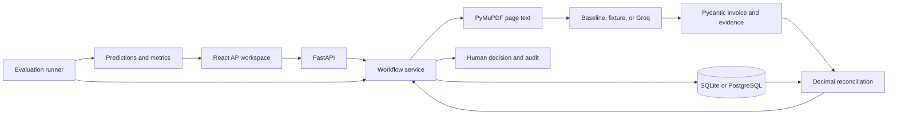
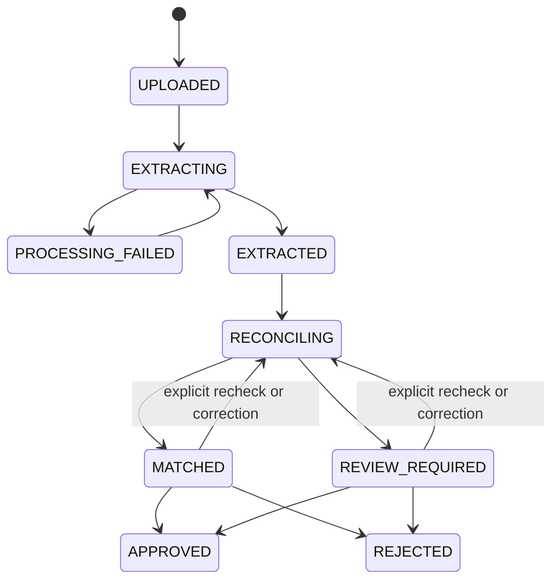

# Architecture

Upload stores bytes and audit metadata atomically. The document hash identifies byte-identical submissions. A unique `(vendor_id, normalized_invoice_number)` claim catches business duplicates with different PDF bytes. Correcting the identity reconciles the claim. The first reconciled record owns it, including records requiring review or subsequently rejected.

Updates reserve the invoice revision with a conditional SQL update. Correction, reconciliation, and audit events commit together. The same approval or rejection request can be retried with its original revision and reason. A competing or stale request gets a conflict, or a retryable 503 on SQLite write contention. After a transient failure the client can refresh the record and retry.

Extraction and reconciliation run synchronously. The transient states are recorded in committed audit history. The database transaction remains open during extraction, so SQLite is suitable for a small local demo. A production queue would claim a job, release the transaction, do extraction in a separate worker, and persist the result with a lease and revision check.

The backend renders previews as page images. It serves the original PDF as an authenticated attachment. Extraction evidence carries page numbers and literal excerpts. The source, order snapshot, current extraction, original extraction, reconciliation result, and review events are separate records or fields. The UI reads those directly.

