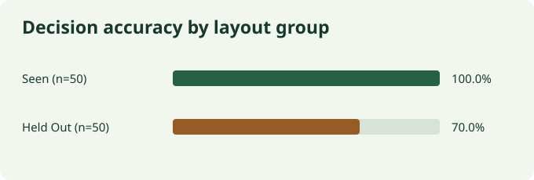

# Evaluation report

Run completed 6 November 2026 at 3:11 am IST on Windows 11, Python 3.12.4, and 16 visible logical CPUs. The runtime reported `Intel64 Family 6 Model 154 Stepping 3, GenuineIntel`. The source fingerprint, renderer, split definition, seed, timestamp, and rules are in the [run manifest](../data/evaluation/metrics.json).

## Reproduce

```powershell
.\.venv\Scripts\python.exe -m scripts.generate_dataset --count 500 --seed 4317
.\.venv\Scripts\python.exe -m scripts.run_evaluation --split dev --output data/runtime/dev-evaluation
.\.venv\Scripts\python.exe -m scripts.run_evaluation --split test --output data/evaluation
.\.venv\Scripts\python.exe -m scripts.benchmark_latency --count 30
```

The baseline uses a hand-authored text parser with no fitted parameters. The development smoke run scored 0.971 field micro-F1 and 100.0% decision accuracy on 100 documents. Test metrics use the separately labeled 100 test documents. The tolerance and duplicate experiments replay the same saved test predictions. The production defaults were kept at zero amount and quantity tolerance.

## Extraction

| Metric | Result | Denominator or counts |
| --- | ---: | --- |
| Micro precision / recall / F1 | 1.000 / 0.896 / 0.945 | 883 TP, 0 FP, 102 FN |
| Macro precision / recall / F1 | 1.000 / 0.897 / 0.939 | 10 fields |
| Missing-field rate | 10.36% | 102/985 labeled present |
| Hallucinated-field rate | 0.00% | 0/15 labeled absent |
| Total amount normalized accuracy | 95.0% | 95/100 expected amounts |
| Line-item F1 | 0.654 | 102 TP, 0 FP, 108 FN |

| Field | Exact accuracy | Normalized accuracy | Missing / expected present |
| --- | ---: | ---: | ---: |
| `invoice_number` | 90.0% | 90.0% | 10/95 |
| `invoice_date` | 95.0% | 95.0% | 5/95 |
| `vendor_name` | 95.0% | 95.0% | 5/100 |
| `vendor_id` | 95.0% | 95.0% | 5/100 |
| `purchase_order_number` | 95.0% | 95.0% | 5/95 |
| `currency` | 95.0% | 95.0% | 5/100 |
| `subtotal` | 95.0% | 95.0% | 5/100 |
| `tax_amount` | 95.0% | 95.0% | 5/100 |
| `total_amount` | 95.0% | 95.0% | 5/100 |
| `line_items` | 48.0% | 48.0% | 52/100 |

Exact accuracy compares serialized values and line order. Normalized comparison ignores case and repeated whitespace, compares numeric values as Decimals, and compares normalized line multisets. Per-field accuracy includes true absences. A correct present value is a TP. An incorrect present value contributes an FP and an FN when truth is present. Omitted expected values contribute FN. F1 is `2TP / (2TP + FP + FN)`. The macro score averages per-field scores. A line match requires equal code, description, quantity, unit price and line total after normalization.

## Reconciliation

| Metric | Result |
| --- | ---: |
| Three-state accuracy | 85/100 · 85.0% |
| Accuracy Wilson 95% interval | 76.7% to 90.7% |
| Exception precision / recall / F1 | 0.548 / 0.927 / 0.689 |
| Exception recall Wilson 95% interval | 86.3% to 96.3% |
| Duplicate recall | 5/5 · 100.0% |
| False approval proxy | 0/70 · 0.0% |
| False exception rate | 15/30 · 50.0% |

| Truth ↓ / Prediction → | Matched | Review required | Processing failed |
| --- | ---: | ---: | ---: |
| Matched | 15 | 15 | 0 |
| Review required | 0 | 65 | 0 |
| Processing failed | 0 | 0 | 5 |

Exception scoring compares distinct `(document, code)` pairs. The default produced 102 true positives, 84 false positives against the business annotations, and 8 false negatives. The false approval proxy counts automatic **Matched** outcomes among documents labeled Review required or Processing failed. Human decisions are separate. False exception rate counts clean documents sent to Review required. Intervals describe this synthetic sample. Document-code pairs and duplicate families can be dependent.

## Generalization

| Layout group | n | Field micro-F1 | Decision accuracy | Exception recall |
| --- | ---: | ---: | ---: | ---: |
| Seen | 50 | 0.976 | 100.0% | 100.0% |
| Held-out Dispatch | 50 | 0.913 | 70.0% | 84.9% |



| Difficulty | n | Field micro-F1 | Decision accuracy | Exception recall |
| --- | ---: | ---: | ---: | ---: |
| difficult | 92 | 0.940 | 83.7% | 92.7% |
| easy | 8 | 1.000 | 100.0% | — |

| PDF quality | n | Field micro-F1 | Decision accuracy | Exception recall |
| --- | ---: | ---: | ---: | ---: |
| corrupt | 5 | 0.000 | 100.0% | 100.0% |
| digital | 95 | 0.971 | 84.2% | 92.4% |

The held-out delimiter prevented item parsing. All 50 Dispatch records either required review or failed processing. Five corrupt files failed across the full test split. There was no scanned/OCR cohort. Per-scenario and per-code results are in the [run manifest](../data/evaluation/metrics.json).

## Operational measures

The core run timed sequential file ingestion, PDF reading, extraction, reconciliation, and commits to fresh disk SQLite, with one document in flight. The per-document timer excludes dataset I/O, seed time, HTTP and report generation. The HTTPX workload adds multipart and API serialization using TestClient and 30 ordered test invoices. Both timings include failed cases.

| Workload | n | p50 | p95 | Serial docs/s |
| --- | ---: | ---: | ---: | ---: |
| Workflow calls with SQLite | 100 | 17.16 ms | 22.93 ms | 56.95 |
| HTTPX TestClient and SQLite | 30 | 33.80 ms | 48.78 ms | 27.34 |

Serial docs/s divides sample count by summed timed durations. This single-stream test does not establish multi-user throughput. Manual review was 80/100 (80.0%) and failures were 5/100 (5.0%). Offline extraction incurred zero API fees.

## Experiments

| Policy | Decision accuracy | Exception recall | Duplicate recall | False matches / expected intervention |
| --- | ---: | ---: | ---: | ---: |
| Default baseline | 85.0% | 92.7% | 100.0% | 0/70 |
| relaxed tolerances | 85.0% | 68.2% | 100.0% | 0/70 |
| no duplicate detection | 82.0% | 88.2% | 0.0% | 3/70 |
| no soft confidence gate | 85.0% | 92.7% | 100.0% | 0/70 |

The relaxed rule allowed an absolute amount difference of 5 currency units and quantity difference of 1. Independent labels retained the original strict policy. The relaxed policy hid variance codes while other checks kept the same records in review. Turning off business duplicate detection missed all five duplicate labels and sent three affected documents to Matched. Two other duplicates still had extraction uncertainty. Removing the soft confidence threshold alone did not change the baseline outcomes because hard unreadable and conflicting evidence checks still applied.

**Groq structured extraction and Groq confidence comparison: NOT EVALUATED.** The adapter is covered by simulated response tests. A live run can compare the default and disabled soft confidence gate on the same outputs. Enter explicit token rates to estimate per-document cost from observed usage. Failed calls without usage are excluded from the numerator, so that estimate is a lower bound when such calls are billable.

## Reliability and artifacts

Pytest exercises timeout and malformed Groq responses, missing purchase orders, a simulated database outage, rollback on audit failure, repeated submissions, competing review decisions, and instruction text in PDFs. The browser smoke uses the real local backend and the baseline provider.

[Raw predictions](../data/evaluation/baseline_predictions.jsonl) · [Metrics and metadata](../data/evaluation/metrics.json) · [Failure examples](../data/evaluation/baseline_failures.json) · [API timings](../data/evaluation/api_latency.json)

